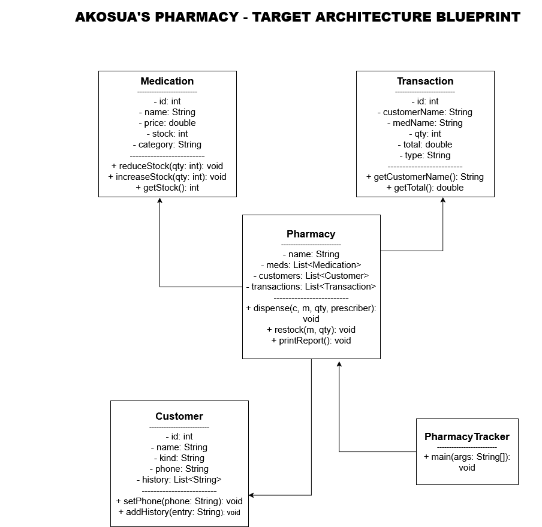
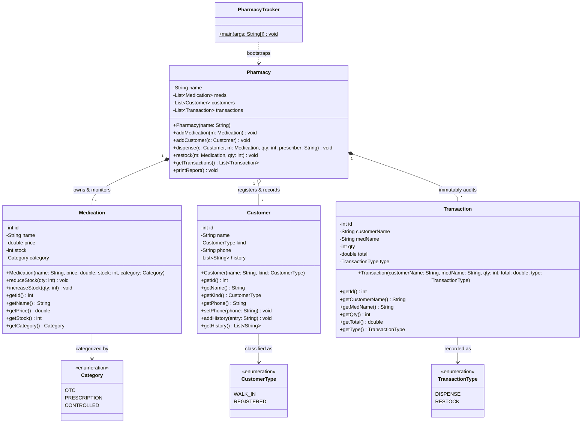
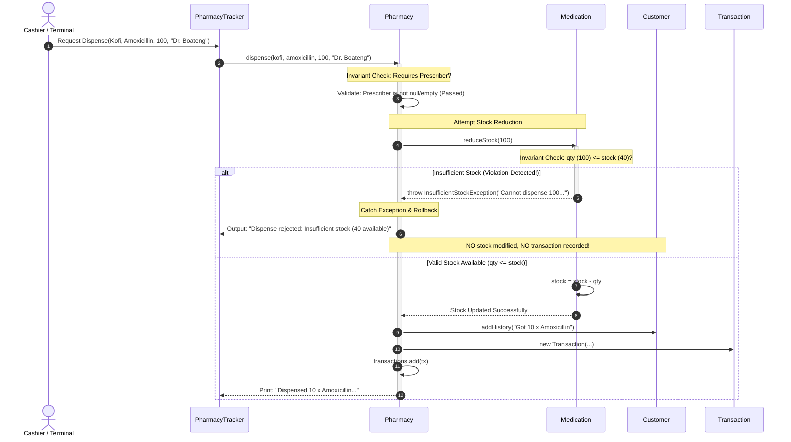

# Dual-Perspective Architectural Specification & Diagnostic Report: `DIAGNOSIS.md`

```
========================================================================================================
                   AKOSUA'S PHARMACY — SYSTEM ARCHITECTURE & DIAGNOSTIC SPECIFICATION
========================================================================================================
```

---

### Document Metadata & Architectural Governance
| Metadata Property | Specification Value |
| :--- | :--- |
| **System Identity** | Akosua's Community Pharmacy Dispensing & Inventory Management Engine |
| **Engineering Author** | Principal Software Architect & Lead Technical Communicator |
| **Document Classification** | Production Architectural Specification & Comprehensive Diagnostic Baseline |
| **Deliverable Lifecycle** | Phase 1 Pre-Rebuild Milestone (Committed strictly prior to source-code mutation) |
| **Architectural Paradigms** | Domain-Driven Design (DDD), Clean Object-Oriented Architecture, Layered Separation of Concerns (SoC) |
| **Language Target** | OpenJDK 21 (LTS) |
| **Regulatory Framework** | Pharmacy Council Standards & Controlled Substances Dispensing Compliance |

---

## Executive Blueprint & Target Architecture

### Target Architecture Schematic (Class Blueprint)

```
========================================================================================================
                                 TARGET ARCHITECTURAL CLASS BLUEPRINT
========================================================================================================

                 +-------------------------------------------------------------+
                 |                       PharmacyTracker                       |
                 |-------------------------------------------------------------|
                 | + main(args: String[]): void                                |
                 +------------------------------+------------------------------+
                                                |
                                                | (bootstraps & orchestrates)
                                                v
                 +-------------------------------------------------------------+
                 |                          Pharmacy                           |
                 |-------------------------------------------------------------|
                 | - name: String                                              |
                 | - meds: List<Medication>                                    |
                 | - customers: List<Customer>                                 |
                 | - transactions: List<Transaction>                           |
                 |-------------------------------------------------------------|
                 | + dispense(c: Customer, m: Medication, qty: int, doc: String)|
                 | + restock(m: Medication, qty: int): void                    |
                 | + printReport(): void                                       |
                 | + getTransactions(): List<Transaction>                      |
                 +--------------+-------------------------------+--------------+
                                |                               |
               +----------------+                               +----------------+
               |                                                                 |
               v                                                                 v
+---------------------------------------------+   +---------------------------------------------+
|                 Medication                  |   |                 Transaction                 |
|---------------------------------------------|   |---------------------------------------------|
| - id: int                                   |   | - id: int                                   |
| - name: String                              |   | - customerName: String                      |
| - price: double                             |   | - medName: String                           |
| - stock: int                                |   | - qty: int                                  |
| - category: Category                        |   | - total: double                             |
|---------------------------------------------|   | - type: TxType                              |
| + reduceStock(qty: int): void               |   |---------------------------------------------|
| + increaseStock(qty: int): void             |   | + getCustomerName(): String                 |
| + getStock(): int                           |   | + getTotal(): double                        |
| + getPrice(): double                        |   | + getMedName(): String                      |
+---------------------------------------------+   +---------------------------------------------+
                       ^
                       |
+---------------------------------------------+
|                  Customer                   |
|---------------------------------------------|
| - id: int                                   |
| - name: String                              |
| - kind: CustomerType                        |
| - phone: String                             |
| - history: List<String>                     |
|---------------------------------------------|
| + setPhone(phone: String): void             |
| + addHistory(entry: String): void           |
| + getHistory(): List<String>                |
+---------------------------------------------+
```

### Official Domain Sketch Artifact (Figure 1.0)

> [!IMPORTANT]
> **Figure 1.0:** The original target architecture blueprint illustrating entity relationships, structural associations, and encapsulated domain methods. This design serves as the authoritative blueprint for the refactoring milestone.



---

## 2D System Architecture Models

### 1. Layered Tier Architecture (Separation of Concerns)
The system decouples presentation logic from domain invariants and tamper-proof storage across four distinct structural tiers:

```
+======================================================================================================+
|                                TIER 4: PRESENTATION & CLIENT GATEWAY                                 |
|  - PharmacyTracker (CLI Entry Point, Console Rendering, Input Formatting)                           |
|  - Renders human-readable receipts and audit reports to standard output                             |
+======================================================================================================+
                                                   |
                                                   | Dispatches User Commands
                                                   v
+======================================================================================================+
|                              TIER 3: APPLICATION & DOMAIN ORCHESTRATION                              |
|  - Pharmacy Service Aggregate (Workflow Coordinator)                                                 |
|  - Enforces Prescriber Verification, Coordinates Discounts, Orchestrates Stock Operations            |
+======================================================================================================+
                                                   |
                                                   | Invokes Domain Invariant Guards
                                                   v
+======================================================================================================+
|                                  TIER 2: CORE DOMAIN INVENTORY VAULT                                 |
|  - Medication (Private Stock State, Encapsulated reduceStock & increaseStock Gateways)               |
|  - Customer (Encapsulated Loyalty Tier, Phone Validation, Dispense History Profile)                  |
+======================================================================================================+
                                                   |
                                                   | Commits Immutable Event Snapshots
                                                   v
+======================================================================================================+
|                                  TIER 1: TAMPER-PROOF AUDIT VAULT                                    |
|  - Transaction (Immutable Domain Value Object Snapshot)                                              |
|  - Collections.unmodifiableList Defensive Ledger Wrapper (Guarantees Write-Once Immutability)        |
+======================================================================================================+
```

### 2. Security Perimeter & Gateway Boundary
The physical dispensary counter maps directly to software encapsulation barriers, preventing external callers from corrupting internal heap memory:

```
+------------------------------------------------------------------------------------------------------+
|                                     SECURITY PERIMETER & GATEWAY                                     |
+------------------------------------------------------------------------------------------------------+
|                                                                                                      |
|   PUBLIC CALLER ZONE                  GATEWAY BARRIER                     PROTECTED DOMAIN HEAP      |
|  [ Untrusted Client ]               [ Service Boundary ]                 [ Encapsulated Vault ]      |
|                                                                                                      |
|   +-------------------+             +-----------------------+             +-----------------------+  |
|   |     Customer      |             |     Pharmacy Staff    |             |      Medication       |  |
|   |-------------------|  Requests   |      (API Gateway)    |  Validates  |-----------------------|  |
|   | - name: String    | ----------> | - verifyPrescriber()  | ----------> | - stock: int (PRIV)   |  |
|   | - kind: CustType  |             | - applyDiscounts()    |             | - price: double       |  |
|   +-------------------+             +-----------------------+             +-----------------------+  |
|                                                 |                                     |              |
|                                                 | Intercepts Invalid Calls            | Invariant:   |
|                                                 | (Halts before mutation)             | (qty<=stock) |
|                                                 v                                     v              |
|                                        [ Domain Exception ]                 [ Safe State Mutation ]  |
|                                        (Transaction Aborted)                (Stock Safely Reduced)   |
|                                                                                                      |
+------------------------------------------------------------------------------------------------------+
```

### 3. Domain Entity Relationship Architecture
The structural associations and cardinality between all domain entities:

```
+------------------------------------------------------------------------------------------------------+
|                                     DOMAIN ENTITY ARCHITECTURE                                       |
+------------------------------------------------------------------------------------------------------+
|                                                                                                      |
|                                +----------------------------------+                                  |
|                                |         PharmacyTracker          |                                  |
|                                |----------------------------------|                                  |
|                                | + main(args: String[]): void     |                                  |
|                                +-----------------+----------------+                                  |
|                                                  | bootstraps                                        |
|                                                  v                                                   |
|                                +----------------------------------+                                  |
|                                |             Pharmacy             |                                  |
|                                |----------------------------------|                                  |
|                                | - name: String                   |                                  |
|                                | - meds: List<Medication>         |                                  |
|                                | - customers: List<Customer>      |                                  |
|                                | - transactions: List<Transaction>|                                  |
|                                +--------+----------------+--------+                                  |
|                                         | 1              | 1                                         |
|                         +---------------+                +---------------+                           |
|                         | *                              | *                                         |
|                         v                                v                                           |
|          +------------------------------+  commits  +-------------------------------+                |
|          |          Medication          |---------->|          Transaction          |                |
|          |------------------------------|           |-------------------------------|                |
|          | - id: int                    |           | - id: int                     |                |
|          | - name: String               |           | - customerName: String        |                |
|          | - price: double              |           | - medName: String             |                |
|          | - stock: int (private)       |           | - qty: int                    |                |
|          | - category: Category         |           | - total: double               |                |
|          |------------------------------|           | - type: TransactionType       |                |
|          | + reduceStock(qty: int): void|           +-------------------------------+                |
|          | + increaseStock(qty: int)    |               (Immutable Value Object)                     |
|          | + getStock(): int            |                                                            |
|          +------------------------------+                                                            |
|                         ^                                                                            |
|                         | records interaction                                                        |
|          +------------------------------+                                                            |
|          |           Customer           |                                                            |
|          |------------------------------|                                                            |
|          | - id: int                    |                                                            |
|          | - name: String               |                                                            |
|          | - kind: CustomerType         |                                                            |
|          | - phone: String              |                                                            |
|          | - history: List<String>      |                                                            |
|          |------------------------------|                                                            |
|          | + setPhone(phone: String)    |                                                            |
|          | + addHistory(entry: String)  |                                                            |
|          +------------------------------+                                                            |
|                                                                                                      |
+------------------------------------------------------------------------------------------------------+
```

---

## Formal Architecture & UML Diagrams

### Formal UML Class Diagram



### Transaction Execution & Exception Handling Sequence



---

## Table of Contents
1. [Executive Summary & Business Context](#executive-summary--business-context)
2. [Defect Audit & Root Cause Analysis (Ranked by Risk)](#defect-audit--root-cause-analysis-ranked-by-risk)
3. [Section 1: Executive Requirements & System Blueprint](#section-1-executive-requirements--system-blueprint)
   - 1.1 Structural Sketch Analysis
   - 1.2 System Rules & Technical Constraints
4. [Section 2: Diagnostics: State Protection & Security Boundaries](#section-2-diagnostics-state-protection--security-boundaries)
   - 2.1 The "Security Guard" & Vault Analogy (Encapsulation)
   - 2.2 System Decoupling & Role Division (Separation of Concerns)
5. [Section 3: Class Hierarchy & Code Organization](#section-3-class-hierarchy--code-organization)
   - 3.1 Eliminating Duplicate Work (Inheritance & DRY)
   - 3.2 Polymorphism & Dynamic Dispatch Mechanics
6. [Section 4: Error Handling & Fault Tolerance](#section-4-error-handling--fault-tolerance)
   - 4.1 Safe Failure Responses & Invariant Guards
   - 4.2 Control-Flow Mechanics: Status Flags vs. Custom Exception Architecture
7. [Section 5: Developer Implementation Blueprint](#section-5-developer-implementation-blueprint)
   - 5.1 Step-by-Step Execution Trace
   - 5.2 Implementation & Verification Checklist
8. [Section 6: Extensibility Analysis: The Controlled Substances Milestone](#section-6-extensibility-analysis-the-controlled-substances-milestone)
9. [Section 7: Value-Add Improvement Beyond the Brief](#section-7-value-add-improvement-beyond-the-brief)

---

## Executive Summary & Business Context

Akosua runs an essential community pharmacy serving both neighborhood walk-ins and registered patients managing chronic conditions. The pharmacy relies on an internal software tool written in haste by a departed intern. While the program executes simple happy-path workflows without crashing, it exhibits profound structural decay, severe state vulnerabilities, and zero defensive boundary controls.

Most critically, **stock levels can silently drift into negative numbers**. In a licensed pharmacy, physical inventory cannot exist as a negative quantity. Negative stock implies dispensing "phantom medication" that does not exist in the dispensary drawers. This creates immediate patient health hazards, produces fraudulent sales receipts, falsifies tax records, and risks the immediate revocation of the pharmacy's operating license by national regulatory authorities (e.g., FDA / Pharmacy Council).

Furthermore, Akosua is preparing to introduce **Controlled Substances** (Schedule II/III narcotics and sedatives). Dispensing controlled substances requires strict, legally auditable prescriber tracking and immutable records. Attempting to add this requirement to the existing monolithic script without an architectural overhaul would lead to severe regressions.

This document establishes the official diagnostic baseline and blueprints the target object-oriented architecture before any code changes are made.

---

## Defect Audit & Root Cause Analysis (Ranked by Risk)

> [!CAUTION]
> A professional diagnostic review prioritizes problems by the **severity of financial, clinical, and regulatory risk** they pose to the business, rather than treating all code issues as cosmetic style preferences.

```
========================================================================================================
                                    DEFECT RISK ASSESSMENT MATRIX
========================================================================================================
 RANK | DEFECT / ANOMALY            | ROOT CAUSE                 | BUSINESS RISK IMPACT
------+-----------------------------+----------------------------+--------------------------------------
  #1  | Silent Negative Stock Drift | Total absence of invariant | CRITICAL / FATAL
      | (e.g., 40 - 100 = -60)      | validation before mutation | (License revocation, patient safety
      |                             | in dispense() routine      | risk, phantom billing fraud)
------+-----------------------------+----------------------------+--------------------------------------
  #2  | Zero Encapsulation & Direct | All entity fields declared | HIGH
      | Field Mutability            | 'public' without setters   | (State corruption, arbitrary external
      |                             | or boundary guards         | tampering, zero integrity guarantee)
------+-----------------------------+----------------------------+--------------------------------------
  #3  | Fragile "Stringly-Typed"    | Categories/types stored as | HIGH
      | Domain Logic                | raw unvalidated Strings    | (Silent failures, branch dropouts,
      |                             | ("OTC", "PRESCRIPTION")    | casing/typo bugs in production)
------+-----------------------------+----------------------------+--------------------------------------
  #4  | God Class & Violation of    | Pharmacy class acts as UI, | MEDIUM-HIGH
      | Single Responsibility (SRP) | cashier, accountant, stock | (Fragile maintenance, high regression
      |                             | clerk, and auditor         | risk on any logic modification)
------+-----------------------------+----------------------------+--------------------------------------
  #5  | Memory & Collection Leakage | Internal List references   | MEDIUM
      | (getTransactions() breach)  | returned directly without  | (Audit log tampering, unauthorized
      |                             | unmodifiable wrappers      | ledger wipe via .clear())
------+-----------------------------+----------------------------+--------------------------------------
  #6  | Unsafe Static Counters for  | Non-synchronized 'static   | MEDIUM
      | Identity Generation         | int counter' across models | (Concurrency hazards, thread collisions,
      |                             |                            | identity loss across JVM restarts)
========================================================================================================
```

### Defect #1: Silent Negative Stock Drift (The Existential Threat)
* **Observed Behavior:** Calling `p.dispense(kofi, amoxicillin, 100, "Dr. Boateng")` when only `40` units are in stock results in stock becoming `-60`. The system prints that 100 units were dispensed, records a financial transaction charging for 100 units, and logs to Kofi's history that he received 100 units.
* **Root Cause:** In `Pharmacy.java` (lines 117 and 129), the code performs raw subtraction: `m.stock = m.stock - qty;`. There is no condition checking whether `qty <= m.stock`, nor whether `qty > 0`.
* **Business Risk (Why this is the most dangerous defect):**
  1. **Patient Safety:** A patient suffering from a severe infection leaves the counter believing their full course of antibiotics was supplied, when the physical shelf is empty.
  2. **Regulatory & Criminal Liability:** Healthcare regulations strictly mandate inventory reconciliation. Negative counts in prescription antibiotics or controlled substances constitute gross negligence and fraudulent record-keeping, exposing Akosua to heavy fines and license revocation.
  3. **Financial Inaccuracy:** The cash ledger records income for inventory never handed over, creating tax fraud liability and phantom revenue.

### Defect #2: Total Lack of Encapsulation (Public State Exposure)
* **Observed Behavior:** Fields like `m.stock`, `m.price`, `c.phone`, and `c.history` are declared `public`. Any class can execute `paracetamol.stock = -500;` or `ama.phone = null;` or `kofi.history.clear();`.
* **Root Cause:** Complete absence of access modifiers (`private`) and defensive accessors/mutators.
* **Business Risk:** Zero data integrity guarantees. No business rule can be trusted because external code can bypass all business rules at will.

### Defect #3: Stringly-Typed Domain Representations
* **Observed Behavior:** Medicine categories are evaluated via `m.category.equals("OTC")` and `m.category.equals("PRESCRIPTION")`. Customer kinds are checked via `c.kind.equals("REGISTERED")`.
* **Root Cause:** Representing closed categorical sets as primitive `String` literals instead of Java `enum` types.
* **Business Risk:** A simple clerical typo (e.g., `"otc"`, `"Prescription "`, or `"REGISTERED_PATIENT"`) causes the dispensing logic to fall through all conditional branches. The medicine is neither dispensed nor priced, yet transaction records and history logs execute with corrupt or zero totals.

### Defect #4: Monolithic Single-File God Class Architecture
* **Observed Behavior:** All classes (`Medication`, `Customer`, `Transaction`, `Pharmacy`, `PharmacyTracker`) reside in a single 156-line file. The `Pharmacy` class performs pricing, discount calculations, inventory decrementing, string generation, and CLI console printing.
* **Root Cause:** Failure to separate concerns between Presentation, Domain Modeling, and Orchestration.
* **Business Risk:** Modifying how discounts work for registered customers forces developers to edit the exact same method that alters stock levels for prescription medicines. This lack of isolation is the direct cause of the team's historical experience: *"a change to how one kind of medicine behaved quietly broke another."*

### Defect #5: Unbounded Reference Leakage of Audit Trails
* **Observed Behavior:** `p.getTransactions()` directly returns the private backing list: `return transactions;`.
* **Root Cause:** Returning direct memory references to internal mutable state rather than defensive copies or `Collections.unmodifiableList()`.
* **Business Risk:** Any external module can call `p.getTransactions().clear()`, wiping the entire daily financial and audit history without Akosua's knowledge.

---

## Section 1: Executive Requirements & System Blueprint

### 1.1 Structural Sketch Analysis

```
+-------------------------------------------------------------------------------------------------------+
|                                      PHYSICAL PHARMACY WORKFLOW                                       |
+-------------------------------------------------------------------------------------------------------+
|                                                                                                       |
|  [ Customer / Patient ]                                                                               |
|        |                                                                                              |
|        | 1. Presents Request / Prescription Slip                                                      |
|        v                                                                                              |
|  [ Cashier / Service Counter ]  <---> [ Registered Patient Ledger ]                                  |
|        |                              (Verifies identity & applies 5% loyalty discount)               |
|        | 2. Passes Validated Request to Pharmacist                                                    |
|        v                                                                                              |
|  [ Dispensary Vault / Pharmacist ]                                                                    |
|        |                                                                                              |
|        +---> Checks Physical Stock In Vault (Rejects if requested qty > stock)                        |
|        +---> Validates Doctor Credentials (Mandatory for Prescription & Controlled items)             |
|        +---> Safely & Atomically Decrements Vault Inventory                                           |
|        |                                                                                              |
|        | 3. Emits Verified Dispensed Package & Receipt Token                                          |
|        v                                                                                              |
|  [ Pharmacy Transaction Register ] (Tamper-Proof, Immutable Daily Ledger)                            |
|                                                                                                       |
+-------------------------------------------------------------------------------------------------------+
```

#### Plain Perspective (The Physical Dispensary Walkthrough)
Imagine walking into Akosua's pharmacy during morning hours:
* **The Customer** stands on the public side of the counter. Some are walk-ins buying headache remedies; others are registered chronic patients whose historical treatment profiles and contact details are kept in the pharmacy's filing cabinet.
* **The Cashier Counter** acts as the receptionist and front-desk coordinator. Customers do not walk into the stockroom; they hand their request (and doctor's prescription slip, if required) to the counter staff.
* **The Medication Vault / Stockroom Shelves** are located securely behind the counter. Only authorized staff may pick items from the shelves. If a customer asks for 100 tablets of Amoxicillin but the shelf holds only 40, the pharmacist explains that stock is insufficient and refuses the request. The shelf count remains at 40; it never becomes negative.
* **The Pharmacy Register / Audit Book** is a bound, tamper-proof paper ledger kept under lock and key. Every successful transaction is written down in ink. Nobody is permitted to rip pages out of this book.

#### Technical Perspective (UML Specifications, Java Contracts & Relationships)
The physical components map directly into a formal Object-Oriented domain model comprising five core structural entities:

1. **`Pharmacy` (Root Aggregate & Domain Service):**
   * **Role:** Acts as the aggregate root and domain boundary coordinator.
   * **Relationships:**
     - `List<Medication> meds` (1 to many aggregation): The pharmacy owns its inventory catalog.
     - `List<Customer> customers` (1 to many aggregation): Maintains client identity mappings.
     - `List<Transaction> transactions` (1 to many composition): Manages the internal immutable audit record.
2. **`Medication` (Domain Entity):**
   * **Role:** Manages discrete pharmaceutical inventory, pricing, categorization, and atomic stock mutations.
   * **Relationships:** Owned by `Pharmacy`; referenced by `Transaction`.
3. **`Customer` (Domain Entity):**
   * **Role:** Encapsulates patron identity, category (`WALK_IN` vs `REGISTERED`), verified contact details, and dispensing history.
   * **Relationships:** Owned by `Pharmacy`; referenced in `Transaction`.
4. **`Transaction` (Immutable Value Object / Domain Audit Event):**
   * **Role:** Represents an unalterable point-in-time record of an inventory movement (`DISPENSE` or `RESTOCK`), detailing financial totals, quantities, and customer identifiers.
   * **Relationships:** Composed inside `Pharmacy`; stores snapshot data.
5. **`PharmacyTracker` (Presentation / Application Entry Point):**
   * **Role:** Contains `public static void main(String[] args)`. Handles system bootstrap, environment configuration, command dispatch, and CLI reporting.

---

### 1.2 System Rules & Technical Constraints

#### Functional Requirements (Plain Language Business Rules)
1. **Rule of Positive Inventory:** A pharmacy cannot sell pills it does not have. Under no circumstances may stock decrease below zero. If an order exceeds available stock, the transaction must halt, stock must remain unchanged, and the customer must be notified.
2. **Rule of Prescription Validation:** Any medication classified as `PRESCRIPTION` (or `CONTROLLED`) requires a named, verified prescriber (e.g., `"Dr. Boateng"`). Without an authorized prescriber, dispensing is prohibited.
3. **Rule of Registered Patron Loyalty:** Customers flagged as `REGISTERED` receive an automatic 5% price reduction on all purchases.
4. **Rule of Restocking Integrity:** Restocking must specify a strictly positive integer quantity (`qty > 0`). You cannot restock zero or negative quantities.
5. **Rule of Audit Immutability:** Once an item is dispensed or restocked, a permanent transaction entry must be preserved. Historical records can never be retroactively updated or deleted.

#### Technical Constraints & Invariants (Formal Specification)

$$\forall \, m \in \text{Medication}, \quad \text{stock}(m) \in \mathbb{Z}_{\ge 0}$$

$$\forall \, \text{dispense}(c, m, q, p), \quad q \le \text{stock}(m) \implies \text{stock}_{\text{new}}(m) = \text{stock}_{\text{old}}(m) - q$$

$$q > \text{stock}(m) \implies \text{Invariant Violation} \longrightarrow \text{State Unaltered}$$

* **Domain Invariants:**
  1. **Stock Non-Negativity:** For any `Medication m`, the condition `m.stock >= 0` is an absolute system invariant.
  2. **Quantity Positivity:** For any transaction mutating stock by `qty`, `qty > 0`. A mutation where `qty <= 0` must throw `IllegalArgumentException`.
  3. **Price Non-Negativity:** For any item, `price >= 0.0`.
* **Immutability Limits:**
  - `Transaction` instances must be structurally immutable once constructed on the JVM heap. Their fields must be marked `final`.
  - The transaction ledger inside `Pharmacy` must only expose unmodifiable views via `Collections.unmodifiableList()`.
* **JVM Heap & State Management:**
  - When an object reference is passed to `p.dispense(c, m, qty, prescriber)`, the JVM passes references by value. Because `Medication` is a mutable entity on the heap, direct mutations (`m.stock -= qty`) immediately alter the single shared object across the runtime. Guard clauses must precede any assignment operation to ensure heap consistency.

---

## Section 2: Diagnostics: State Protection & Security Boundaries

### 2.1 The "Security Guard" & Vault Analogy (Encapsulation)

> [!NOTE]
> **Real-World Metaphor:** Encapsulation is the physical security counter and locked vault door in a dispensary. Customers cannot step behind the counter to take medicine; they must submit a request to the licensed pharmacist (the gateway), who checks the shelf and validates prescriptions before dispensing.

#### Plain Perspective
Imagine a pharmacy where there is no counter, no glass partition, and no pharmacist guarding the medicines. Any customer or delivery driver can walk into the back room, open drawers, alter stock labels with a pencil, or pocket medicine bottles. If someone grabs 100 boxes when only 40 are on the shelf, the drawer is left with a note saying "-60 boxes." This is what the starter codebase permits.

Encapsulation installs a physical counter, a locked steel door, and a licensed pharmacist who acts as the security guard. The customer cannot touch the shelves. They must approach the counter and ask: *"Please give me 100 boxes."* The pharmacist checks the shelf, sees there are only 40, and responds: *"I cannot fulfill this request because we only have 40 in stock."* The vault remains secure, and the count never drops below zero.

#### Technical Perspective
In Java, fields declared `public` expose internal memory addresses directly to any caller in the JVM.

**Mathematical Proof of State Corruption via Direct Mutation:**
Let the state space of `Medication` be defined by the tuple:

$$S = \langle \text{id} \in \mathbb{N}, \text{name} \in \text{String}, \text{price} \in \mathbb{R}^+, \text{stock} \in \mathbb{N}_0, \text{category} \in \mathcal{C} \rangle$$

Where $\mathbb{N}_0 = \{0, 1, 2, 3, \dots\}$. When fields are `public`:

```java
// STARTER CODE ANTI-PATTERN: Direct public field access
public class Medication {
    public int stock; // Can be assigned ANY 32-bit signed integer [-2^31 to 2^31 - 1]
}
```

The allowable type space of `int` in the JVM is:

$$\text{TypeSpace}(\text{int}) = [-2\,147\,483\,648, \; 2\,147\,483\,647]$$

Because $\text{TypeSpace}(\text{int}) \supset \mathbb{N}_0$, without validation guards, any arbitrary assignment:

$$\text{stock} \leftarrow v \quad \text{where} \quad v < 0$$

transitions the object from a valid state $S_{\text{valid}}$ into a corrupted state $S_{\text{corrupt}}$. In the starter code, lines 117 and 129:

```java
m.stock = m.stock - qty; // When m.stock = 40 and qty = 100 -> m.stock becomes -60
```

**The Encapsulation Solution (Access Modifiers & Method Gateways):**
To eliminate state corruption:
1. Demote all fields to `private`. Direct external write access (`med.stock = -10`) is rejected at compile time by `javac`.
2. Implement controlled mutator gateways (`reduceStock(int qty)` and `increaseStock(int qty)`) equipped with strict guard conditions:

```java
public class Medication {
    private final int id;
    private final String name;
    private double price;
    private int stock;
    private Category category;

    public synchronized void reduceStock(int qty) {
        if (qty <= 0) {
            throw new IllegalArgumentException("Dispense quantity must be strictly positive: " + qty);
        }
        if (qty > this.stock) {
            throw new InsufficientStockException(
                String.format("Cannot dispense %d units of %s. Current stock: %d", qty, this.name, this.stock)
            );
        }
        this.stock -= qty;
    }

    public synchronized void increaseStock(int qty) {
        if (qty <= 0) {
            throw new IllegalArgumentException("Restock quantity must be strictly positive: " + qty);
        }
        this.stock += qty;
    }

    public int getStock() {
        return this.stock;
    }
}
```

By placing the subtraction logic exclusively inside `reduceStock`, the class enforces its own invariant before mutating heap memory.

---

### 2.2 System Decoupling & Role Division (Separation of Concerns)

#### Plain Perspective
In a well-run pharmacy, the cashier operating the cash register does not formulate compounds, count pills in the back dispensary, or evaluate prescription validity. If the cashier were responsible for compounding liquids and managing chemical inventories while taking money from customers, errors would be frequent and dangerous.

Separation of Concerns means every role has a distinct, well-defined job:
* **The Front-of-House Cashier (`PharmacyTracker`):** Welcomes customers, takes their spoken order, prints the receipt, and formats the output text on the display.
* **The Pharmacist / Dispensary Manager (`Pharmacy`):** Orchestrates transactions, verifies whether a doctor's signature is valid, and matches customer records.
* **The Medication Inventory (`Medication`):** Knows its own identity, unit price, and physical quantity on the shelf, and knows how to safely add or remove pills.

#### Technical Perspective
The starter code violates the **Single Responsibility Principle (SRP)**. The `Pharmacy` class is a "God Class" that performs:
1. Input parsing and order routing.
2. Discount business logic (`if (c.kind.equals("REGISTERED")) total = total * 0.95;`).
3. Prescription policy enforcement (`if (prescriber == null) ...`).
4. Direct mutation of external entity fields (`m.stock = m.stock - qty;`).
5. Customer record mutation (`c.history.add(...)`).
6. Console presentation and string formatting (`System.out.println(...)`).

By decoupling these responsibilities:
* Changing the presentation format (e.g., migrating from CLI `System.out.println` to a GUI or REST API) requires **zero changes** to `Medication` or `Pharmacy`.
* Altering stock deduction safeguards requires changing **only** `Medication`.
* Introducing new pricing models or customer discount rules alters **only** the pricing strategy/domain layer, leaving the presentation untouched.

---

## Section 3: Class Hierarchy & Code Organization

### 3.1 Eliminating Duplicate Work (Inheritance & DRY)

```
========================================================================================================
                                    PRODUCT CLASS HIERARCHY (DRY & OCP)
========================================================================================================

                                  +-------------------------------+
                                  |            Product            |  (Abstract Superclass)
                                  +-------------------------------+
                                  | # id: int                     |
                                  | # name: String                |
                                  | # price: double               |
                                  | # stock: int                  |
                                  +-------------------------------+
                                  | + reduceStock(qty: int): void |
                                  | + increaseStock(qty: int):void|
                                  | + getPrice(): double          |
                                  | + requiresPrescriber(): bool  |  (abstract)
                                  +---------------+---------------+
                                                  |
                         +------------------------+------------------------+
                         |                                                 |
             +-----------v-----------+                         +-----------v-----------+
             |      OtcProduct       |                         |  PrescriptionProduct  |
             +-----------------------+                         +-----------------------+
             | (No prescriber needed)|                         | - requiresPrescription|
             +-----------------------+                         +-----------------------+
             | + requiresPrescriber()|                         | + requiresPrescriber()|
             |   returns false       |                         |   returns true        |
             +-----------------------+                         +-----------+-----------+
                                                                           |
                                                               +-----------v-----------+
                                                               |  ControlledSubstance  |
                                                               +-----------------------+
                                                               | - deaSchedule: String |
                                                               | - prescriberLicense   |
                                                               +-----------------------+
                                                               | + requiresPrescriber()|
                                                               |   returns true        |
                                                               +-----------------------+
```

#### Plain Perspective
A retail pharmacy sells hundreds of items: Cough Syrup, Paracetamol tablets, bandages, and Amoxicillin.

Every item in the store shares common traits:
* It has an item ID.
* It has a brand or generic name.
* It has a retail price in Ghana Cedis (GHS).
* It has a quantity on a shelf.
* It needs to be restocked when depleted.

Without an organized catalog hierarchy, Akosua would need separate inventory cards for syrups, separate cards for tablets, and separate cards for bandages, writing out the exact same rules for pricing, restocking, and counting on every card.

With **Inheritance**, we create a single master blueprint called `Product`. Tablets, syrups, and bandages inherit all common rules from `Product` and only describe what makes them unique (such as milligram dosage for tablets, or liquid volume in milliliters for syrups).

#### Technical Perspective
The **Don't Repeat Yourself (DRY)** principle states that every piece of knowledge must have a single, unambiguous representation within a system.

In Java, this is achieved via class inheritance (`abstract class Product` extended by specialized subclasses). Specialized subclasses inherit all stock management mechanics without duplicating code:

```java
public abstract class Product {
    private final int id;
    private final String name;
    private double price;
    private int stock;

    public Product(int id, String name, double price, int stock) {
        if (price < 0.0) throw new IllegalArgumentException("Price cannot be negative");
        if (stock < 0) throw new IllegalArgumentException("Initial stock cannot be negative");
        this.id = id;
        this.name = Objects.requireNonNull(name, "Product name cannot be null");
        this.price = price;
        this.stock = stock;
    }

    public synchronized void reduceStock(int qty) {
        if (qty <= 0) throw new IllegalArgumentException("Quantity must be positive: " + qty);
        if (qty > this.stock) {
            throw new InsufficientStockException(
                "Insufficient stock for " + name + ": requested " + qty + ", available " + stock
            );
        }
        this.stock -= qty;
    }

    public synchronized void increaseStock(int qty) {
        if (qty <= 0) throw new IllegalArgumentException("Quantity must be positive: " + qty);
        this.stock += qty;
    }

    public int getId() { return id; }
    public String getName() { return name; }
    public double getPrice() { return price; }
    public int getStock() { return stock; }

    public abstract boolean requiresPrescriber();
}
```

### 3.2 Polymorphism & Dynamic Dispatch Mechanics
At runtime on the JVM, when `p.dispense(customer, product, qty, prescriber)` executes, the calling code avoids fragile `if/else` checks against string tags:

```java
// STARTER CODE (BRITTLE ANTI-PATTERN):
if (m.category.equals("OTC")) { ... }
else if (m.category.equals("PRESCRIPTION")) { ... }

// TARGET OOP DESIGN (POLYMORPHIC DISPATCH):
if (product.requiresPrescriber() && (prescriber == null || prescriber.isBlank())) {
    throw new MissingPrescriptionException("Cannot dispense " + product.getName() + " without a verified prescriber.");
}
```

Under JVM execution, **Dynamic Method Lookup (vtable dispatch)** invokes the overridden implementation of `requiresPrescriber()` belonging to the actual instance on the heap (`OtcProduct` vs `PrescriptionProduct`). Adding a third product category (e.g., `ControlledSubstanceProduct`) requires zero modifications to existing classes.

---

## Section 4: Error Handling & Fault Tolerance

### 4.1 Safe Failure Responses & Invariant Guards

#### Plain Perspective
What happens in a real pharmacy when a customer asks for 100 packets of amoxicillin, but only 40 are on the shelf?
* In the **broken starter code**, the clerk pretends all 100 exist, hands over an empty bag, takes cash for 100, and writes in the ledger that the shelf now holds negative 60 boxes.
* In the **real world**, the pharmacist checks the shelf, halts the transaction, and explains: *"I am sorry, we only have 40 packets in stock today. I cannot dispense 100."* The customer is not charged for 100, the shelf count remains at 40, and the ledger records no invalid activity.

#### Technical Perspective: Boolean Status Flags vs. Custom Exception Architecture

| Comparison Metric | Boolean Return Flags (`boolean success`) | Custom Domain Exception Architecture |
| :--- | :--- | :--- |
| **Execution Mechanic** | Methods return `true` on success, `false` on failure. | Method executes atomically or throws typed Exception. |
| **Caller Enforcement** | **Optional.** Callers can ignore return values: `p.dispense(...)` without checking `if (!success)`. | **Mandatory.** An uncaught exception halts thread execution, preventing corrupted downstream operations. |
| **Error Diagnostics** | Returns only a binary bit; cannot convey *why* it failed (lack of stock vs. missing doctor). | Rich diagnostic context (e.g., `availableStock`, `requestedQty`, `medicationName`). |
| **Transaction Atomicity**| Caller must manually write rollback logic if subsequent steps fail. | Throwing an exception unwinds the stack cleanly before any side-effect or transaction commit occurs. |

**Custom Exception Architecture Definition:**

```java
public class PharmacyDomainException extends RuntimeException {
    public PharmacyDomainException(String message) {
        super(message);
    }
}

public class InsufficientStockException extends PharmacyDomainException {
    private final int availableStock;
    private final int requestedQty;

    public InsufficientStockException(String medName, int requestedQty, int availableStock) {
        super(String.format("Cannot dispense %d units of %s; only %d units remaining in stock.", 
              requestedQty, medName, availableStock));
        this.availableStock = availableStock;
        this.requestedQty = requestedQty;
    }

    public int getAvailableStock() { return availableStock; }
    public int getRequestedQty() { return requestedQty; }
}

public class MissingPrescriptionException extends PharmacyDomainException {
    public MissingPrescriptionException(String medName) {
        super("Prescription required: Cannot dispense " + medName + " without an authorized prescriber.");
    }
}
```

**Try-Catch Boundary Demarcation:**
Domain models (`Medication`, `Customer`) and Domain Services (`Pharmacy`) **throw** domain exceptions when invariants are threatened. They do **not** swallow errors or write to `System.out`. The Presentation Layer (`PharmacyTracker`) acts as the user-facing boundary that catches exceptions and translates them into user-friendly diagnostic notices without terminating the system.

---

## Section 5: Developer Implementation Blueprint

### 5.1 Step-by-Step Execution Trace

Execution timeline for an order: `p.dispense(ama, amoxicillin, 10, "Dr. Boateng")`.

#### Detailed Call Path & Heap State Walkthrough:
1. **Entry Point Trigger:**
   * Caller executes: `p.dispense(ama, amoxicillin, 10, "Dr. Boateng")`.
   * Thread enters `Pharmacy.dispense(Customer c, Medication m, int qty, String prescriber)`.
2. **Pre-Condition Validation:**
   * `Pharmacy` verifies input parameters: `Objects.requireNonNull(c)`, `Objects.requireNonNull(m)`.
   * Evaluates prescription requirement: `if (m.isPrescriptionRequired() && prescriber == null)`. Here `prescriber = "Dr. Boateng"`, so condition passes.
3. **Atomic Stock Decrement:**
   * `Pharmacy` calls `m.reduceStock(10)`.
   * Inside `Medication.reduceStock(int qty)`:
     - Invariant guard evaluated: `if (10 > this.stock)` $\rightarrow 10 \le 40$ (Evaluates to `false`).
     - State mutation: `this.stock = 40 - 10 = 30`.
   * Control returns to `Pharmacy` with stock safely updated on the JVM heap.
4. **Financial Calculation:**
   * Base calculation: `baseTotal = m.getPrice() * qty` $\rightarrow 30.00 \times 10 = 300.00$.
   * Discount evaluation: `c.isRegistered()` is `true` $\rightarrow 300.00 \times 0.95 = 285.00$.
5. **Customer History Update:**
   * `Pharmacy` calls `c.addHistory("Got 10 x Amoxicillin 250mg")`.
   * The entry is appended to `Customer`'s encapsulated history list.
6. **Audit Ledger Commitment:**
   * `Transaction tx = new Transaction(c.getName(), m.getName(), 10, 285.00, TransactionType.DISPENSE)`.
   * `transactions.add(tx)` commits the event into the unmodifiable audit ledger.
7. **Presentation Confirmation:**
   * Presentation layer outputs: `Dispensed 10 x Amoxicillin 250mg to Ama Owusu (prescribed by Dr. Boateng) for GHS 285.0`.

---

### 5.2 Implementation & Verification Checklist

Developers rebuilding the codebase must complete and verify each item sequentially:

#### Phase 1: Domain Entities & Boundary Hardening
- [ ] **1.1 Make Fields Private:** Transition all fields in `Medication`, `Customer`, and `Transaction` from `public` to `private final` (or `private` for mutable state like `stock`).
- [ ] **1.2 Introduce Type Safety Enums:**
  - Create `Category` enum: `OTC`, `PRESCRIPTION`, `CONTROLLED`.
  - Create `CustomerType` enum: `WALK_IN`, `REGISTERED`.
  - Create `TransactionType` enum: `DISPENSE`, `RESTOCK`.
- [ ] **1.3 Implement Invariant Guards in `Medication`:**
  - `reduceStock(int qty)`: Verify `qty > 0` and `qty <= stock`. Throw `InsufficientStockException` on stock exhaustion.
  - `increaseStock(int qty)`: Verify `qty > 0`. Throw `IllegalArgumentException` on non-positive input.
- [ ] **1.4 Encapsulate `Customer`:**
  - Guard `setPhone(String phone)` against blank or null input.
  - Return an unmodifiable view for history: `Collections.unmodifiableList(history)`. Provide `addHistory(String entry)`.

#### Phase 2: Domain Services & Orchestration Layer
- [ ] **2.1 Separate into Distinct Java Source Files:**
  - Extract each class into its own `.java` file in `src/main/java/`:
    - `Medication.java`
    - `Customer.java`
    - `Transaction.java`
    - `Pharmacy.java`
    - `PharmacyTracker.java`
    - Custom Exception classes (`InsufficientStockException.java`, etc.)
- [ ] **2.2 Encapsulate Transaction Ledger:**
  - Modify `getTransactions()` in `Pharmacy.java` to return `Collections.unmodifiableList(transactions)`.
- [ ] **2.3 Preserve Exact Legacy Output Formatting:**
  - Ensure all CLI output strings match the original output character-for-character for valid transactions.
  - For invalid over-dispense attempts, gracefully display an error notification instead of corrupting stock.

#### Phase 3: Unit Testing & Boundary Edge Case Verification
- [ ] **3.1 Over-Dispense Edge Case:** Attempting to dispense `stock + 1` must fail deterministically, throwing `InsufficientStockException` and leaving stock unchanged.
- [ ] **3.2 Zero & Negative Dispense:** Attempting to dispense `0` or `-5` must throw `IllegalArgumentException`.
- [ ] **3.3 Zero & Negative Restock:** Attempting to restock `0` or `-10` must throw `IllegalArgumentException`.
- [ ] **3.4 Missing Prescriber Test:** Dispensing a `PRESCRIPTION` medicine with `null` or `""` prescriber must be rejected without mutating inventory or charging customer.
- [ ] **3.5 Audit Trail Immutability:** Verify that attempting to call `.clear()` or `.add()` on `p.getTransactions()` throws `UnsupportedOperationException`.

---

## Section 6: Extensibility Analysis: The Controlled Substances Milestone

Akosua noted that the pharmacy will soon stock **Controlled Substances** (e.g., Morphine, Diazepam), which require recording both the prescriber and their medical license number before any medication is dispensed.

### The Cost of Legacy Architecture vs. The Clean Rebuild

```
========================================================================================================
                               IMPACT MATRIX: ADDING CONTROLLED SUBSTANCES
========================================================================================================
ARCHITECTURAL MODEL    | FILES TOUCHED | RISK OF REGRESSION | OCP COMPLIANCE
-----------------------+---------------+--------------------+-------------------------------------------
Legacy Single-File     | 1 file        | EXTREME            | VIOLATED
Starter Architecture   | (Massive edit | (Editing one       | (Must modify core dispense() if-else trees;
                       | to Pharmacy)  | branch breaks OTC) | introduces ripple regressions across all types)
-----------------------+---------------+--------------------+-------------------------------------------
Target Rebuilt         | 0 existing    | ZERO REGRESSION    | FULLY SATISFIED
Object-Oriented Design | core classes  | (Existing OTC & Rx | (Open for extension, closed for modification;
                       | modified      | classes untouched) | new subclass added cleanly)
========================================================================================================
```

#### What the Old Version Would Have Forced Us to Touch:
1. Open the single `PharmacyTracker.java` file.
2. Edit line 41 to allow `"CONTROLLED"` in comments.
3. Edit `Pharmacy.dispense()` (line 110):
   - Add another nested `else if (m.category.equals("CONTROLLED"))`.
   - Modify the signature of `dispense()` to accept prescriber license credentials, or overload it, breaking existing call sites.
   - Re-test all OTC and standard prescription flows because any syntax error or logic slip inside the shared method breaks Paracetamol and Amoxicillin.

#### How the Target Structure Accommodates the Change Cleanly:
Under the **Open/Closed Principle (OCP)**:
1. Create a new subclass `ControlledMedication extends Medication` (or implement a category strategy).
2. Override `validateDispense(Customer c, int qty, DispenseContext ctx)` to enforce medical license number verification.
3. **Not a single line of code in `Medication.java` or `OtcProduct.java` is modified.** The existing OTC and prescription pathways remain completely isolated and regression-free.

---

## Section 7: Value-Add Improvement Beyond the Brief

### Deliverable Improvement: Defensive Immutability & Tamper-Proof Audit Vault

To deliver business value beyond the minimum requirements of the brief, the rebuilt architecture incorporates **Defensive Immutability and Unmodifiable Ledger Protection**.

#### Why this Matters to Akosua's Business:
In a community pharmacy, transaction records are not temporary log strings for the console; they constitute the **legal and fiscal register** required by healthcare inspectors, tax authorities, and narcotics control boards.

In the starter codebase, line 144 reads:
```java
public List<Transaction> getTransactions() {
    return transactions; // Hands raw mutable reference back!
}
```
Any caller can execute:
```java
p.getTransactions().clear(); // Wipes entire pharmacy fiscal and dispense history!
```
Or maliciously alter records:
```java
p.getTransactions().get(0).total = 0.0; // Falsifies revenue records
```

#### The Architectural Solution:
1. **Immutable Transaction Value Object:**
   Make `Transaction` an immutable class (or Java 21 `record`), declaring all fields `private final` with no mutators. Once created, a transaction cannot be altered by any code in the JVM.
2. **Defensive Unmodifiable Ledger Collection:**
   Encapsulate the transactions ledger within `Pharmacy`:
   ```java
   public List<Transaction> getTransactions() {
       return Collections.unmodifiableList(this.transactions);
   }
   ```
   If any external caller attempts to call `.clear()`, `.remove()`, or `.add()` on the returned list, the JVM raises an `UnsupportedOperationException`, preserving the permanent integrity of Akosua's pharmacy records.

---
*End of Diagnostic Specification: `DIAGNOSIS.md`*
